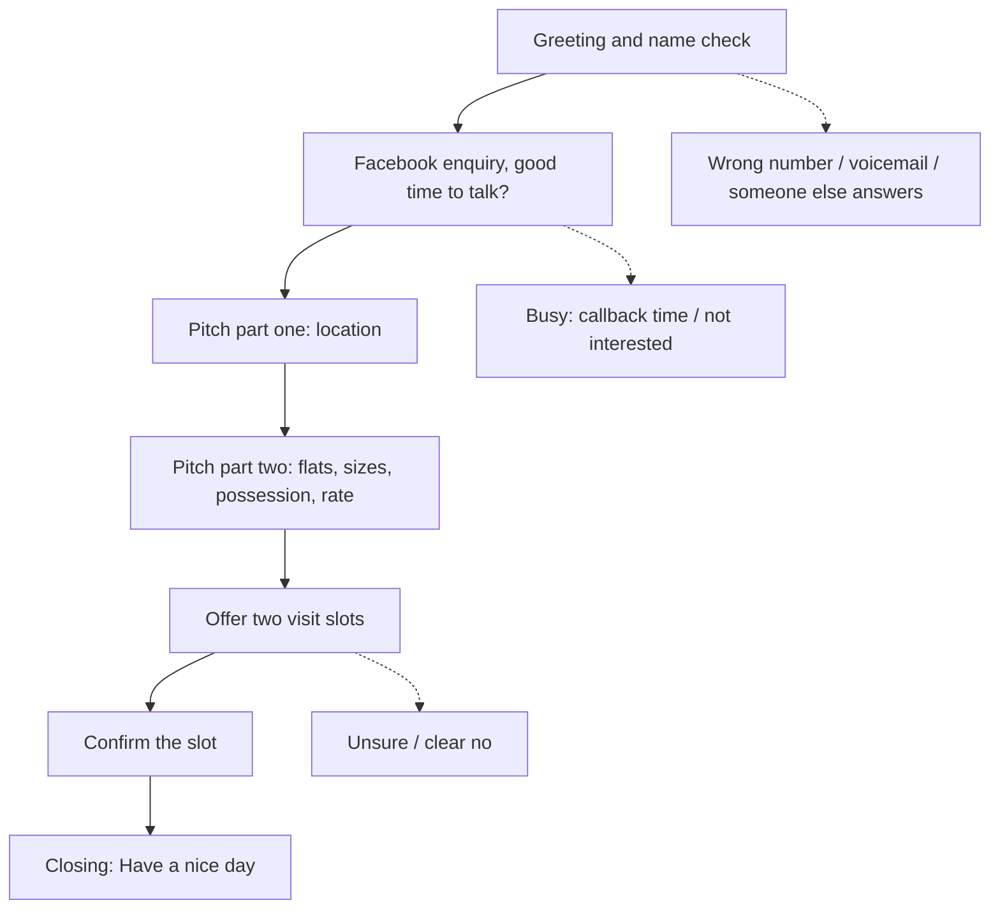

# Mira

Mira is a voice agent that calls people who enquired about Mahima Palm Springs, a gated township on Tonk Road, Jaipur. She talks in Hinglish, gives a short pitch, answers questions from a fixed set of facts, and tries to book a site visit.

## Demo

[](https://www.youtube.com/watch?v=MINxNsXnHMI)

## How a call goes

1. Greeting and name check
2. Mentions the Facebook enquiry and asks if it's a good time
3. Pitch in two short turns: location first, then flats, sizes, possession and the rate
4. Offers two of the four daily visit slots (11 AM, 1 PM, 3 PM, 5 PM)
5. Confirms the slot and ends with "Have a nice day."

If the customer is busy, she asks when to call back. Wrong numbers, voicemail, "don't call me again", abuse and silence each have their own closing line. If she's asked something outside the facts (amenities, RERA, loans, discounts), she doesn't guess; she offers a callback from a senior expert.



## Setup

| | |
|---|---|
| Platform | Vapi (can also be deployed to Bolna from the same files) |
| Model | GPT-4.1, temperature 0.2, max 250 tokens per reply |
| Voice | Cartesia Arushi, Sonic 3.6, language `hi` |
| Speech-to-text | Deepgram Nova-3 (`multi`) on Vapi, Soniox `stt-rt-v5` on Bolna |
| Turn-taking | Waits 0.5 s before speaking; the caller needs 2+ words to interrupt |
| Silence | Asks "can you hear me?" after 10 s, closes the call after 20 s |
| Limits | 5 minute max call, voicemail detection, noise filtering, recording on |
| Hang-up | The call ends when Mira says "Have a nice day". The model has no hang-up tool, so it can't end a call without saying goodbye. |

A few things about the prompt that aren't obvious from reading it:

- Every line is written in Roman script. The Cartesia voice reads Roman Hinglish and English fine but can't handle Devanagari mixed with Roman text, so the sync script refuses to deploy a spoken line that contains Devanagari.
- Numbers, prices and times are written out as words ("five thousand five hundred rupees per square foot") so the voice never has to guess how to read digits.
- Each reply is at most three short sentences with one question. This is stated once near the top of the prompt, and the scripted lines are written to fit inside it.
- Every `Mira:` line is followed by an `Instructions:` line that tells the model what to do depending on the customer's reply.

## Files

```
prompt/mira_prompt.md    the prompt
config/settings.json     model, voice, transcriber, first message, call limits
scripts/sync.py          deploys the prompt and settings, then checks the live agent matches
tests/cases.json         test conversations and what each reply should do
tests/run_evals.py       runs the tests on Vapi Evals
.env.example             keys and IDs (copy to .env, never commit it)
```

## Running it

Copy `.env.example` to `.env` and fill in your keys. `PLATFORM` is `vapi` or `bolna`. `VAPI_API_KEY` is the main Vapi key; `VAPI_API_KEY2` and `VAPI_API_KEY3` are optional extra accounts (a fallback and a test account), picked with `VAPI_ACCOUNT` (`auto`, `primary`, `spare` or `third`). Assistant IDs are written to `.env` the first time the script creates them.

Python 3, no extra packages:

```
python3 scripts/sync.py            # deploy to the platform in PLATFORM
python3 scripts/sync.py --check    # just check the live agent against the files
python3 scripts/sync.py --all      # deploy to every configured agent
```

After deploying, the script reads the live agent back and checks the prompt, first message, model, voice, transcriber, hang-up phrase and call limits. On Vapi it also deletes stale dashboard drafts, so close the Mira tab in the dashboard before syncing.

## Tests

Each test is a scripted customer conversation. The real model writes Mira's replies, and each reply is checked in two ways: plain text checks (no digits, no Devanagari, at most three sentences and one question, nothing after "Have a nice day"), and a GPT-4.1 judge that checks the reply against what that step should do.

```
python3 tests/run_evals.py --set all             # main suite
python3 tests/run_evals.py --set fresh           # extra held-back cases
python3 tests/run_evals.py --ids T01,T05         # specific cases
python3 tests/run_evals.py --set all --dry-run   # show the plan and estimated cost
```

Tests only run on a test Vapi account (`--account third` by default, or `--account spare`), never the main one. Results go to `tests/results/`. Only the results of the final run on the current prompt are committed: `final_run.json` (main suite, 42 of 50 passed) and `final_fresh_run.json` (held-back cases, 14 of 15 passed).

The tests are text only, so they don't cover voice quality, pronunciation, speech-to-text on real audio or interruptions. Those still need real calls.
