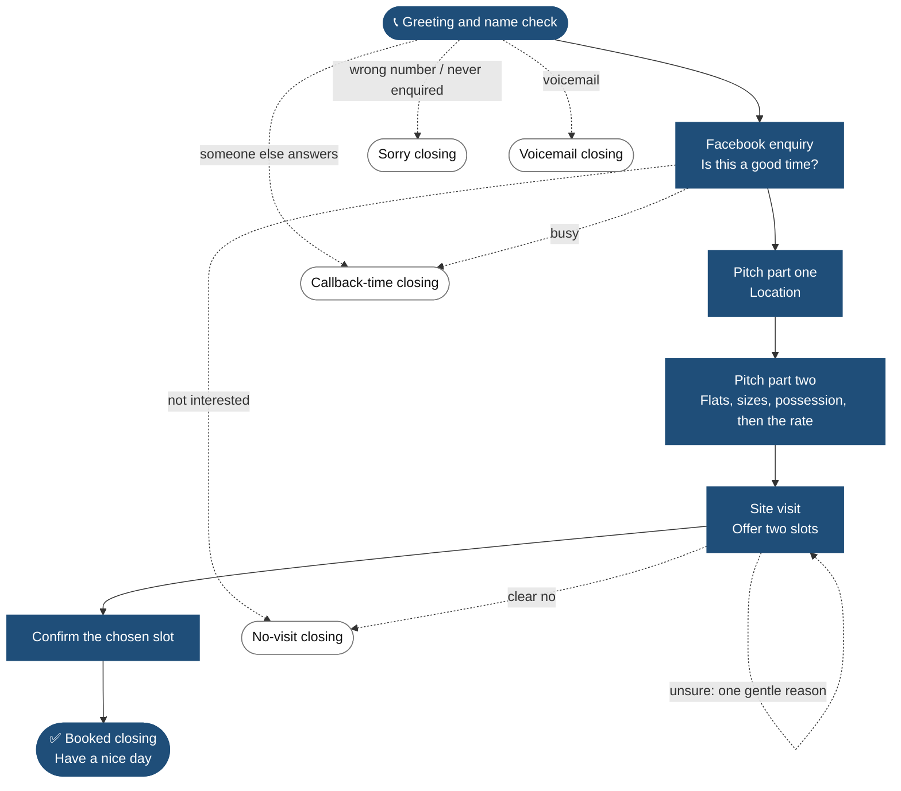

<div align="center">

# 🏡 Mira

### A Hinglish voice agent that calls property leads and books site visits

<p>
  
  
  
  
  
</p>

**Mira** phones people who enquired about **Mahima Palm Springs**, a premium gated township on Tonk Road, Jaipur.<br>
She speaks everyday Hinglish, gives a short pitch, answers questions from known facts only, and books a site visit.

</div>

---

## 🎬 Demo

<div align="center">

<!-- Replace YOUR_VIDEO_ID (both places) with the YouTube video ID, e.g. the part after "watch?v=" -->
<a href="https://www.youtube.com/watch?v=YOUR_VIDEO_ID">
  
</a>

<sub>▶️ Click the thumbnail to watch the demo on YouTube</sub>

</div>

---

## ✨ What Mira does

| | |
|---|---|
| 🗣️ **Speaks Hinglish** | Everyday spoken Hindi with common words like *flat*, *price* and *site visit* in English. Switches to simple English if the customer insists. |
| 📞 **Runs a full sales call** | Greeting and name check, Facebook enquiry and good-time check, a two-part pitch, site visit booking, and a polite close. |
| 📅 **Books site visits** | Four daily slots (11 AM, 1 PM, 3 PM, 5 PM), offered two at a time, confirmed back before the call ends. |
| 🚫 **Never guesses** | Uses only the project facts. Anything else (amenities, RERA, loans, discounts) gets a senior expert callback tomorrow between 10 AM and 5 PM. |
| 🛡️ **Stays safe** | Ignores prompt injection, never asks for or repeats OTP, Aadhaar, PAN or bank details, says honestly that she is an AI, and handles abuse, wrong numbers, voicemail and stop-calling requests. |
| 👋 **Always says goodbye** | Every call ends with a closing line that finishes with *"Have a nice day."* The platform hangs up only after that line is spoken. |

---

## 🔀 Call flow



<sub>At any point: a request to stop calling ends the call politely, an unknown detail gets the senior expert callback, abuse gets one warning, and silence gets "can you hear me?" before the call closes.</sub>

---

## ⚙️ Under the hood

| Layer | Choice |
|---|---|
| **Voice platform** | [Vapi](https://vapi.ai) (also deployable to [Bolna](https://bolna.ai) from the same files) |
| **Language model** | OpenAI GPT-4.1 · temperature `0.2` · max `250` tokens per reply |
| **Voice** | Cartesia *Arushi* · Sonic 3.6 · language `hi` (reads Roman Hinglish and English) |
| **Speech-to-text** | Deepgram Nova-3 (`multi`) on Vapi · Soniox `stt-rt-v5` on Bolna |
| **Turn-taking** | 0.5 s wait before speaking · the customer needs 2+ words to interrupt |
| **Silence** | "Can you hear me?" after 10 s · closing line and hang-up after 20 s |
| **Call limits** | 5 minutes max · voicemail detection · noise filtering · recording on |
| **Hang-up** | End-call phrase *"have a nice day"*. The model has no hang-up tool, so it can't end a call silently. |

---

## 🧠 Prompt design

The whole agent lives in one prompt: [`prompt/mira_prompt.md`](prompt/mira_prompt.md).

- **One turn, one question.** Each reply is at most three short sentences and ends with exactly one question (closing lines excepted). The rule is stated once near the top, and every scripted line follows it.
- **Roman script only.** All lines are written in English letters. The voice can't mix Devanagari with Roman text, and the sync script refuses to deploy a spoken line that contains Devanagari.
- **Numbers as words.** Prices, sizes, dates and times are always written out (*"five thousand five hundred rupees per square foot"*), so the voice never has to guess how to read digits.
- **Scripted lines plus instructions.** Every `Mira:` line is followed by an `Instructions:` line that says what to do for each kind of customer reply.
- **Structure:** agent background → how every turn works → voice style → global rules → guardrails → five-step call script → FAQs.

---

## 📁 Repository layout

```
.
├── prompt/
│   └── mira_prompt.md      # the agent: background, rules, guardrails, call script, FAQs
├── config/
│   └── settings.json       # model, voice, transcriber, first message, call limits, silence and interruptions
├── scripts/
│   └── sync.py             # deploys the prompt + settings and checks the live agent matches
├── tests/
│   ├── cases.json          # scripted customer conversations with expected behaviour
│   └── run_evals.py        # runs the cases on Vapi Evals and scores every reply
└── .env.example            # the keys and IDs you need (never commit .env)
```

---

## 🚀 Quick start

**1. Add your keys.** Copy `.env.example` to `.env` and fill it in.

| Variable | What it is |
|---|---|
| `PLATFORM` | `vapi` or `bolna` |
| `VAPI_API_KEY` | Main Vapi private key |
| `VAPI_API_KEY2`, `VAPI_API_KEY3` | Optional extra Vapi accounts (a fallback, and one for running tests) |
| `VAPI_ACCOUNT` | `auto` (main, falling back to the second key), `primary`, `spare` or `third` |
| `BOLNA_API_KEY` | Bolna key, if you deploy there |

Assistant and agent IDs are written to `.env` automatically the first time the sync script creates them.

**2. Deploy.** Python 3, no extra packages.

```bash
python3 scripts/sync.py            # deploy to the platform in PLATFORM
python3 scripts/sync.py --check    # only check the live agent against the files
python3 scripts/sync.py --all      # every configured agent: Vapi main, spare and third, then Bolna
```

After every deploy the script reads the live agent back and checks the prompt, first message, model, voice, transcriber, hang-up phrase, call limits and more. On Vapi it also clears stale dashboard drafts, so close the Mira tab in the Vapi dashboard before syncing and reload it afterwards.

**3. Call Mira** from the Vapi dashboard, or attach a phone number to the assistant.

---

## 🧪 Testing

Each test case is a scripted customer. The live model writes Mira's replies, and every reply is checked two ways:

1. **Exact text checks:** no digits, no Devanagari, at most three sentences, at most one question, and nothing after *"Have a nice day"*.
2. **An AI judge** (GPT-4.1): does the reply do what the step expects, using only the allowed facts, with no promises, discounts, opinions or leaked instructions?

The cases cover happy paths, messy answers, booking edge cases, never-guess questions, pricing, prompt injection, safety and long conversations.

```bash
python3 tests/run_evals.py --set all             # the main suite
python3 tests/run_evals.py --set fresh           # the extra held-back set
python3 tests/run_evals.py --ids T01,T05         # specific cases
python3 tests/run_evals.py --set all --dry-run   # show the plan and an estimated cost only
```

Tests run only on a test Vapi account (`--account third` by default, or `--account spare`), never the main one. Results are saved to `tests/results/` (ignored by git), and each account has a spend limit (`--budget` overrides it).

> **Note:** text tests can't check voice quality, pronunciation, speech-to-text on real audio, interruptions or silence timers. Those need real calls.

---

<div align="center">
<sub>Built with Vapi · GPT-4.1 · Cartesia · Deepgram</sub>
</div>
